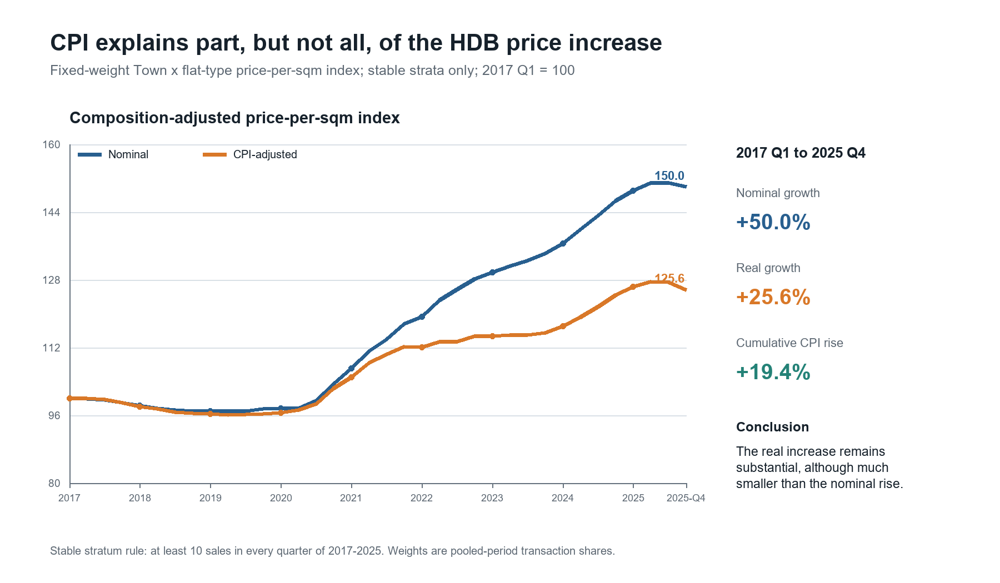

# Q4：扣除 CPI 后，HDB 转售价格变化是否仍然明显？

这是本人负责的研究部分。分析复用小组共享数据库，数据库建库及共享预处理工作不计入本人的 Q4 贡献。

## 研究结论

2017-Q1 至 2025-Q4，转售价格在扣除 CPI 后仍明显上涨，实际涨幅低于名义涨幅。

| 比较 | 名义变化 | CPI 调整后的变化 |
| --- | ---: | ---: |
| 市场转售价中位数 | +52.4% | +27.5% |
| 固定 Town×户型构成的每平方米价格指数 | +50.0% | +25.6% |

同期 All-items CPI 上涨约 19.4%。实际固定构成指数的正向趋势约为 3.6%/年，Newey–West 95% 区间约 2.7%–4.4%，`p < 0.001`。这里的年化趋势来自时间回归，区别于端点计算的实际 CAGR（约 2.64%）。

剔除疑似重复标记后，实际累计涨幅仅变化约 +0.12 个百分点。补充比较截至 2026-Q2，固定构成实际指数相对 2017-Q1 仍上涨约 24.2%。

精确数字保存在 [analysis_summary.json](hdb_cpi_adjusted_price_analysis_output/analysis_summary.json)。

## 数据与方法

1. 通过 [SQL](queries/q4_transactions.sql) 连接 `fact_resale_transaction`、`dim_town`、`dim_flat_type` 和 `dim_time_month`，保留完整季度、正价格且可进行 CPI 调整的交易。
2. 主比较期为 2017-Q1 至 2025-Q4，共 36 个季度。查询额外保留 2026-Q1/Q2 以作补充，总计 234,293 笔交易、38 个季度。
3. 交易实值公式为 `实际价格（2024 SGD）= 名义价格 × 100 ÷ 当月 All-items CPI（2024=100）`。代码使用数据库中已预处理的实值字段，先调整交易金额，再按季度计算中位数。
4. 以 2017-Q1=100 分别指数化季度名义价与实际价，同时比较全市场中位数与固定构成指数。
5. 固定构成分析保留主比较期每个季度至少 10 笔交易的 Town×户型组合，共 69 组。权重来自这些组在 **2017–2025 全主比较期的合并交易份额**，之后保持不变；以加权几何平均汇总季度组内每平方米价格中位数。
6. 对实际固定构成指数的对数拟合季度线性趋势，使用 4 阶 Newey–West 标准误和正态近似置信区间/双侧检验。
7. 保留疑似重复记录作为基准，再剔除标记记录重新估计，检查结论稳健性。

权重与基期需区分：**2017-Q1 是指数基期，不是代码计算权重时使用的唯一季度**。PPT 若出现 “Fixed 2017-Q1 weights”，应以这里及代码中的全期合并权重定义解释；本次整理保留现有 PPT 文件。

## 文件

| 文件 | 用途 |
| --- | --- |
| `hdb_cpi_adjusted_price_analysis.py` | SQL 读取、季度/年度汇总、固定构成指数、趋势和敏感性分析 |
| `queries/q4_transactions.sql` | 独立保存的同口径查询 |
| `hdb_cpi_adjusted_price_analysis_output/quarterly_price_summary.csv` | 全市场季度价格与 CPI 汇总 |
| `hdb_cpi_adjusted_price_analysis_output/annual_price_summary.csv` | 完整年度汇总 |
| `hdb_cpi_adjusted_price_analysis_output/composition_adjusted_index.csv` | 固定构成季度指数 |
| `hdb_cpi_adjusted_price_analysis_output/duplicate_sensitivity.csv` | 疑似重复记录敏感性比较 |
| `hdb_cpi_adjusted_price_analysis_output/analysis_summary.json` | 精确结果与样本口径 |
| `hdb_cpi_adjusted_price_analysis_output/*.png` | 五张分析图 |



## 运行

以下命令从仓库根目录执行。

```bash
python -m pip install -r Q4/requirements.txt
python Q4/hdb_cpi_adjusted_price_analysis.py
```

MySQL 默认数据库为 `hdb_project`。密码交互输入，或由本机 `HDB_DB_PASSWORD` 环境变量提供。数据库导入见 [仓库 README](../README.md)。

不安装 MySQL 时，可从同一处理数据生成本地验证库：

```bash
python scripts/build_q4_sqlite.py
python Q4/hdb_cpi_adjusted_price_analysis.py --sqlite tmp/q4_validation.sqlite --output-dir tmp/q4_reproduced
```

仓库保留原有结果文件；复现输出写入被 Git 忽略的 `tmp/q4_reproduced/`。原有 JSON 标注的数据源为 `SQLite (q4_validation.sqlite)`，默认代码同时提供小组要求的 MySQL 读取方式。

## PPT 对应部分

[小组 PPT](../presentations/MH6142_Database_System_Group_Project_Times_New_Roman_Formatted.pptx) 的第 21–25 页：

| 页码 | 内容 |
| --- | --- |
| 21 | Q4 研究问题与章节页 |
| 22 | SQL 提取、CPI 调整与检验方法 |
| 23 | 名义价与 CPI 调整后的价格趋势 |
| 24 | 固定市场构成后的价格趋势 |
| 25 | 结果解释、局限与结论 |

## 解释边界

All-items CPI 衡量一般消费价格通胀，并不是 HDB 资产价格的专门基准。固定分组减少 Town 和户型构成变化的影响，不能控制所有房屋特征。趋势回归和敏感性分析支持描述性结论，不能据此判断价格上涨的因果机制。
