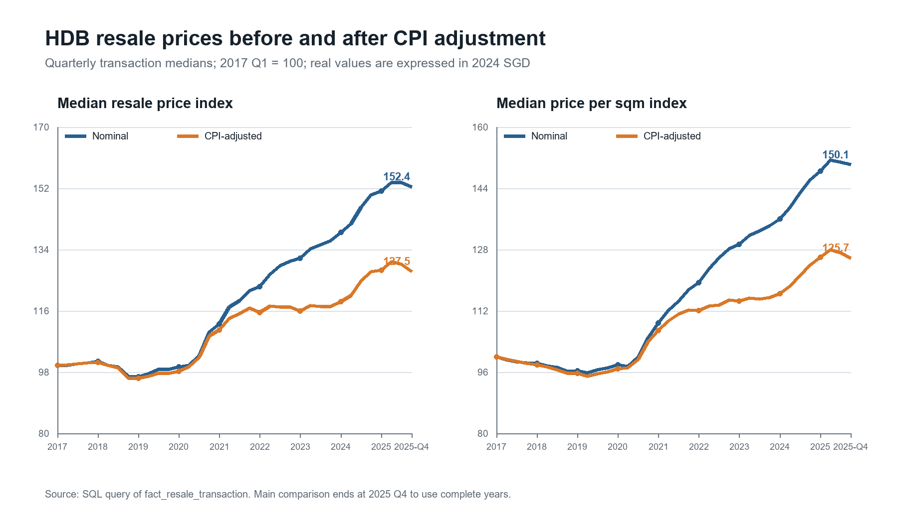

# Singapore HDB Database Project

MH6142 Database System 小组项目：研究 2017 年以来新加坡 HDB 转售价、租金比例以及剩余租期相关的市场差异。

本仓库整理已有的小组材料，并单独说明本人负责的 **Q4：转售价格的变化，在扣除 CPI 通胀后是否仍然明显？**

## 我的部分：Q4

入口：[Q4 研究说明、方法和结果](Q4/README.md) · [个人贡献说明](CONTRIBUTIONS.md) · [分析代码](Q4/hdb_cpi_adjusted_price_analysis.py)

主比较期为 2017-Q1 至 2025-Q4。

| 指标 | 累计变化 |
| --- | ---: |
| 市场转售价中位数，名义价格 | +52.4% |
| 市场转售价中位数，2024 年不变价 | +27.5% |
| 固定 Town×户型构成的每平方米名义价格指数 | +50.0% |
| 同一固定构成指数，扣除 CPI 后 | +25.6% |
| 同期 All-items CPI | +19.4% |

扣除 CPI 后，转售价格上涨仍然明显。通胀解释了名义涨幅的一部分；上述结果描述趋势和关联。



## 仓库内容

```text
Q4/                         本人负责的 CPI 调整分析、SQL、结果表与图
team/Q1/                    队友提供的户型价格趋势分析与输出
team/Q3/                    队友提供的剩余租期分析与输出
data/                       小组共享预处理代码、10 张处理表及数据说明
database/hdb_project.sql.gz  队友建立的共享 MySQL 数据库，压缩后保存
presentations/              已完成字体与排版调整的小组 PPT
docs/                       原有项目要求
scripts/                    数据库解压和 Q4 本地复现辅助脚本
```

Q2 的现有展示在小组 PPT 中；本地交付材料未包含独立的 Q2 源代码。本仓库没有把其他组员的分析或共享数据库归为本人的贡献。

## 运行 Q4

使用 Python 3.10 或以上版本。建议新建虚拟环境后安装 Q4 依赖：

```bash
python -m pip install -r Q4/requirements.txt
```

### 使用小组 MySQL 数据库

数据库由 Q1 队友建立。首次使用时，先解压共享备份：

```bash
python scripts/unpack_database.py
```

在 MySQL Workbench 中新建空的 `hdb_project` schema，然后使用 **Server → Data Import → Import from Self-Contained File** 导入 `database/hdb_project.sql`。备份包含 `DROP TABLE IF EXISTS`，请导入空的项目 schema，避免覆盖已有同名表。

从仓库根目录运行：

```bash
python Q4/hdb_cpi_adjusted_price_analysis.py
```

默认连接 `localhost:3306`，数据库为 `hdb_project`，用户名为 `root`；密码会交互输入。也可用 `HDB_DB_HOST`、`HDB_DB_PORT`、`HDB_DB_USER`、`HDB_DB_NAME`、`HDB_DB_PASSWORD` 环境变量配置。密码不随仓库提供。

### 无需 MySQL 的复现路径

利用仓库中的处理数据建立 SQLite 验证库，再运行原 Q4 SQL/分析流程：

```bash
python scripts/build_q4_sqlite.py
python Q4/hdb_cpi_adjusted_price_analysis.py --sqlite tmp/q4_validation.sqlite --output-dir tmp/q4_reproduced
```

这条路径用于本地复现，不替代课程项目的 MySQL 实现。原 `analysis_summary.json` 记录的验证输入也是 SQLite。

Q1、Q3 的额外依赖可通过 `python -m pip install -r requirements-team.txt` 安装；其原始连接方式以各自脚本为准。

## 数据来源和版本

数据来自 HDB、data.gov.sg 及 SingStat CPI。详见 [官方数据链接](data/02_dataset_links/dataset_links.txt)、[数据字典](data/04_delivery_notes/data_dictionary_zh.md) 和 [质量报告](data/04_delivery_notes/processing_quality_report_zh.md)。

当前交付材料使用 2026-10-07 下载的数据快照。Q4 主分析使用 2017–2025 的 36 个季度；2026-Q2 仅作补充。重新下载官方数据可能得到不同记录数。

处理后的全量转售事实表有 242,144 行；Q4 经完整季度、正价格和实值可用性等条件筛选后查询 234,293 笔交易，覆盖 38 个季度。两者统计口径不同。

## PPT

[小组展示文件](presentations/MH6142_Database_System_Group_Project_Times_New_Roman_Formatted.pptx) 中，第 **21–25 页**为 Q4 部分。PPT 沿用已完成版本，本次仓库整理未改动其内容。

## 来源与使用

共享预处理、数据库、队友分析及 PPT 的来源见 [贡献说明](CONTRIBUTIONS.md)。原有数据来源和 PPT 模板署名随材料保留。公开展示不改变这些原有归属，也未对全组材料统一添加新的开源授权。
